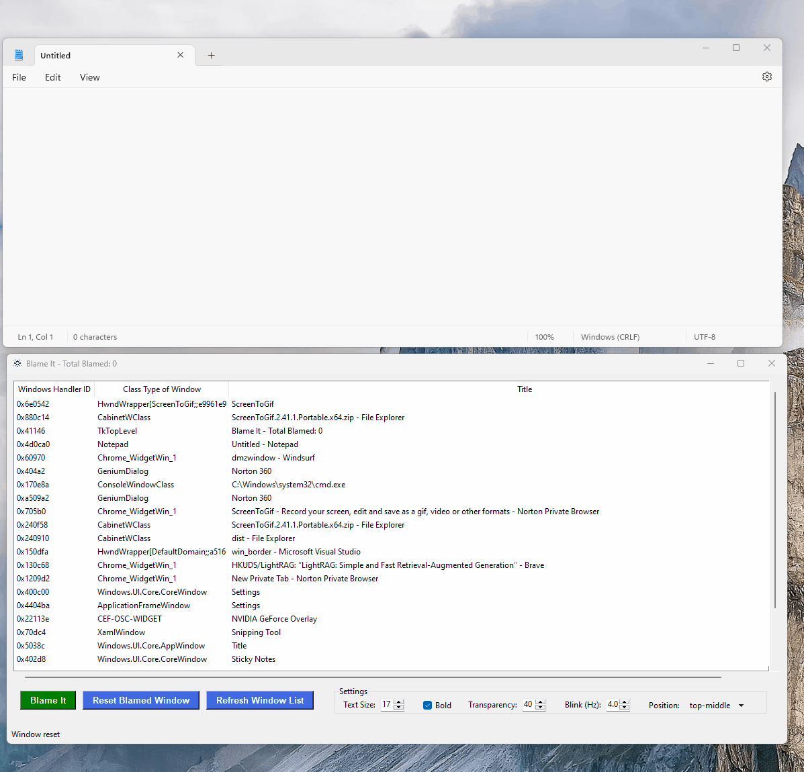

# Blame Window

(Behind the scenes, you are monitoring and managing multiple servers. Sometimes you are scared of mixing production and staging environments on those black console/putty windows). 

This is a Windows utility that allows you to highlight and mark windows with colored borders and alert messages. Perfect for system administrators, developers, or anyone who needs to track and identify multiple windows.

## What is DMZWindow?



## Features

- Add colored borders to any window
- Display customizable alert messages
- Adjustable text size and transparency
- Configurable blinking effects
- Multiple position options for alert messages
- Real-time window tracking
- Easy-to-use interface with window list

## Installation

### Option 1: Run from Source
1. Ensure you have Python 3.x installed
2. Install required packages:
   ```
   pip install pywin32
   ```
3. Run `main.py`:
   ```
   python main.py
   ```

### Option 2: Standalone Executable
1. Download `DMZWindow.exe` from the releases
2. Run the executable directly - no installation required

## Usage

1. Launch the application
2. Select a window from the list
3. Click "Blame It" button
4. Choose a border color
5. Enter alert text (optional)
6. Customize settings:
   - Text Size (8-24pt)
   - Bold Text (On/Off)
   - Transparency (0-90%)
   - Blink Rate (0.5-5 Hz)
   - Alert Position (top-left, top-middle, top-right)

## Building from Source

To create your own executable:
```
pyinstaller --onefile --windowed --icon=blame.ico --name=DMZWindow main.py
```

## Requirements

- Windows Operating System
- For source code:
  - Python 3.12+
  - pywin32

## License

[All rights reserved](LICENSE)

## Contributing

Feel free to open issues or submit pull requests for any improvements or bug fixes.